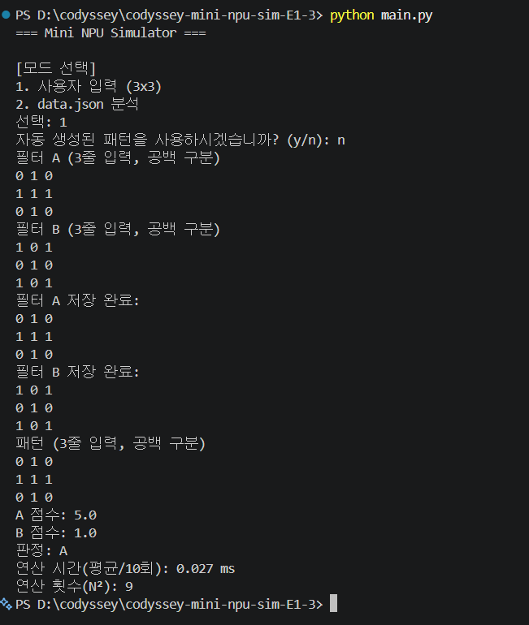
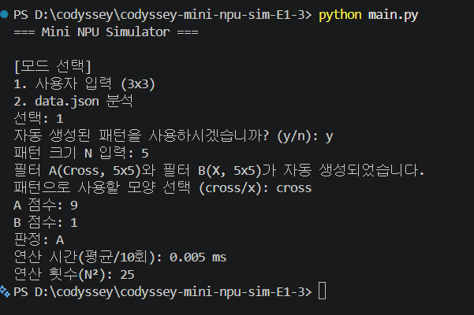
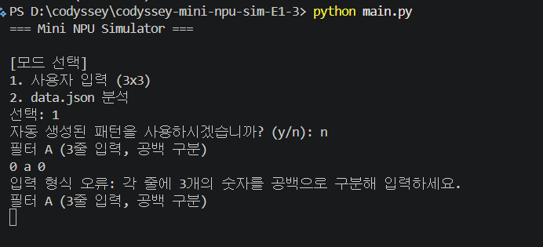
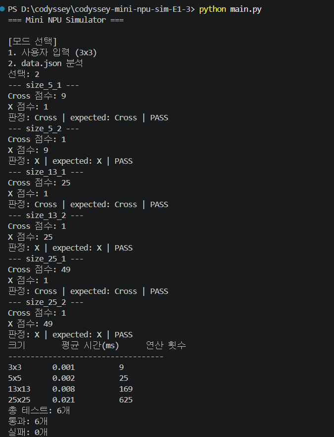
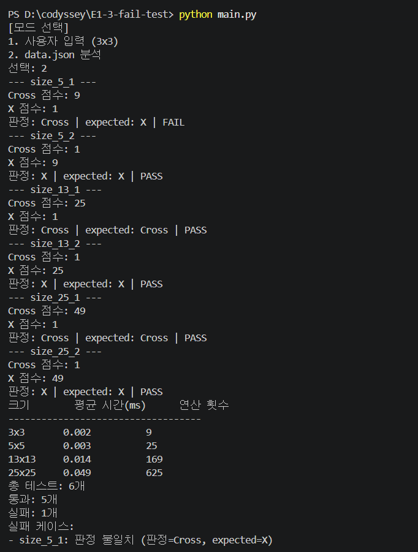
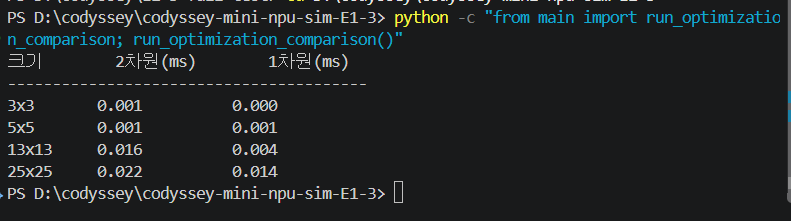

# Mini NPU Simulator

> 이 프로젝트는 "곱해서 더하는" 계산(MAC)으로 모양(십자, X)을 구분하는 프로그램이다. AI가 이미지를 알아볼 때 쓰는 가장 기본적인 계산을 파이썬으로 직접 만들어 본 것이다.
>
> 처음 읽는다면 §1 → §3-1 → §8만 봐도 전체 흐름을 알 수 있고, 나머지는 검증 자료다.

## 목차

- [1. 프로젝트 개요](#1-프로젝트-개요)
- [2. 실행 방법](#2-실행-방법)
- [3. 구현 요약](#3-구현-요약)
  - [3-1. MAC 연산](#3-1-mac-연산)
  - [3-2. 라벨 정규화](#3-2-라벨-정규화)
  - [3-3. 동점(epsilon) 처리 정책](#3-3-동점epsilon-처리-정책)
  - [3-4. data.json 생성](#3-4-datajson-생성)
- [4. 결과 리포트](#4-결과-리포트)
  - [4-1. FAIL 케이스 분석](#4-1-fail-케이스-분석)
  - [4-2. 성능 표 해석과 시간 복잡도](#4-2-성능-표-해석과-시간-복잡도)
- [5. 재현성](#5-재현성)
- [6. 파일 구조](#6-파일-구조)
- [7. 보너스 과제](#7-보너스-과제)
  - [7-1. 시뮬레이터 최적화 (1차원 배열 변환)](#7-1-시뮬레이터-최적화-1차원-배열-변환)
  - [7-2. 패턴 생성기](#7-2-패턴-생성기)
- [8. 실행 화면](#8-실행-화면)

## 1. 프로젝트 개요

AI의 MAC(Multiply-Accumulate) 연산 원리를 직접 구현한 Python 콘솔 애플리케이션이다. 두 가지 모드를 제공한다: 사용자가 직접 3×3 필터/패턴을 입력하는 모드, `data.json`에 저장된 5×5/13×13/25×25 패턴을 일괄 판정하는 모드.

**왜 만드는가.** AI 모델의 계산은 일반적으로 "곱해서 더하는" 연산(MAC, Multiply-Accumulate)을 아주 많이 반복하는 것으로 이루어진다. 예를 들어 이미지에서 특정 모양을 찾을 때는 모양 틀(필터)을 이미지(패턴)에 겹쳐 같은 위치끼리 곱한 뒤 모두 더하고, 점수가 높을수록 그 모양과 닮았다고 본다.

**NPU란 무엇인가.** NPU(Neural Processing Unit, 신경망 처리 장치)는 AI 계산을 위해 설계된 전용 칩이다. 일반적으로 CPU는 여러 종류의 일을 차례로 처리하는 범용 칩이고, GPU는 같은 계산을 한꺼번에 많이 처리하는 데 강하다. NPU는 AI에서 가장 많이 반복되는 MAC 계산을 많은 계산기에 나눠 동시에 처리하도록 만들어서, 같은 AI 계산을 더 빠르고 적은 전력으로 할 수 있다. 스마트폰의 사진·음성 인식처럼 AI 기능을 기기 안에서 돌릴 때 쓰이는 경우가 많다. 이 프로젝트의 "시뮬레이터"는 그 핵심 계산(MAC)을 파이썬 코드로 흉내 내 본다는 뜻이다.

**이 프로젝트의 범위.** 이 프로그램은 실제 NPU 하드웨어나 신경망 학습을 구현한 것이 아니다. MAC 계산 한 번의 원리, 즉 "패턴과 필터를 겹쳐 점수를 구하고 점수가 높은 쪽으로 판정한다"는 과정을 파이썬 반복문으로 직접 구현해 확인하는 소규모 시뮬레이터다.

**용어.** 패턴은 판정할 그림, 필터는 비교 기준이 되는 모양(Cross는 십자, X는 엑스), `expected`는 그 패턴이 무엇이어야 하는지 정해 둔 정답 라벨이다. 라벨은 "이 그림은 십자(Cross)다"처럼 붙여 둔 이름표(정답 표시)이고, `data.json`은 테스트용 패턴과 필터를 모아 둔 파일이다. 콘솔 애플리케이션은 터미널(콘솔) 창에서 글자로 입력하고 결과를 글자로 보는 프로그램이다.

## 2. 실행 방법

```bash
python main.py
```

Python 3.8 문법과 표준 라이브러리 범위 안에서 작성했다(3.8 문법으로 파싱해 확인했고, 실제로 실행해 확인한 버전은 3.14.8이다). Python 표준 라이브러리(파이썬에 기본으로 들어 있는 기능)만 사용하며, 별도 패키지 설치가 필요 없다.

실행하면 모드 선택 메뉴(1: 사용자 입력, 2: data.json 분석)가 나타난다. `data.json`은 `main.py`와 같은 폴더(프로젝트 루트)에 있어야 하며, `main.py`는 어느 폴더에서 실행해도 자기 위치 기준으로 이 파일을 찾는다. 없을 경우 프로젝트 폴더에서 `python generate_data.py`를 실행해 다시 만들 수 있다(`generate_data.py`는 현재 폴더에 `data.json`을 만든다).

## 3. 구현 요약

### 3-1. MAC 연산

`compute_mac_score(pattern, filter_)`는 이중 for문으로 같은 위치의 값을 곱해서 누적 합산한다. NumPy(숫자 계산용 외부 도구) 등 외부 라이브러리 없이 직접 구현했다.

3×3 예시에서 패턴이 Cross 모양일 때의 계산이다.

```text
패턴(Cross)   필터 A(Cross)   필터 B(X)
0 1 0         0 1 0           1 0 1
1 1 1         1 1 1           0 1 0
0 1 0         0 1 0           1 0 1
```

같은 위치의 값을 곱해서 모두 더한다. 필터 A와는 1이 겹치는 칸이 5개라 점수가 5.0이고, 필터 B와는 가운데 1칸만 겹쳐 1.0이다. 점수가 높은 A로 판정한다.

```python
def compute_mac_score(pattern, filter_):
    n = len(pattern)
    score = 0
    for i in range(n):
        for j in range(n):
            score += pattern[i][j] * filter_[i][j]
    return score
```

`for i`는 행을, 안쪽 `for j`는 그 행의 열을 하나씩 돌아서(이중 for문), 3×3이면 9칸을 한 번씩 방문한다. 각 칸에서 패턴 값과 필터 값을 곱해 `score`에 더한다.

### 3-2. 라벨 정규화

`normalize_label(label)`은 `data.json`의 `expected` 값(`'+'`, `'x'`)과 필터 키(`'cross'`, `'x'`)를 표준 라벨(`Cross`, `X`)로 통일한다. 대소문자를 구분하지 않고 처리한다.

`data.json`은 정답(`expected`)을 `"+"`, `"x"`로, 필터 키를 `"cross"`, `"x"`로 적어 두어서 그대로는 서로 비교할 수 없다. 예를 들어 판정 결과 `Cross`와 정답 `"+"`는 문자열이 달라서 항상 다른 값으로 취급된다. 그래서 모두 `Cross`/`X`로 맞춘 뒤 비교한다.

```python
def normalize_label(label):
    key = str(label).strip().lower()
    if key in ("+", "cross"):
        return "Cross"
    if key == "x":
        return "X"
    raise ValueError(f"알 수 없는 라벨입니다: {label}")
```

알 수 없는 값이 들어오면 `ValueError`를 내고, 모드2에서는 이 오류를 받아 해당 케이스만 FAIL로 처리한다(§4-1).

### 3-3. 동점(epsilon) 처리 정책

`judge_scores(score_a, score_b, epsilon=1e-9)`는 두 점수 차이가 `1e-9`보다 작으면 동점(`TIE`, 화면에는 "판정 불가"/"UNDECIDED")으로 처리한다.

일반적으로 컴퓨터는 소수를 근사값으로 저장하기 때문에(부동소수점), 수학적으로 같은 값이 미세하게 다르게 계산될 수 있다. Python에서 `0.1 + 0.2 == 0.3`은 `False`이고, `0.1 + 0.2`는 `0.30000000000000004`로 계산된다. 소수 입력을 받는 모드1에서는 이런 미세한 차이가 생길 수 있어서 점수 차이가 `epsilon`(기본값 `1e-9`)보다 작으면 동점으로 본다.

```python
def judge_scores(score_a, score_b, epsilon=1e-9):
    if abs(score_a - score_b) < epsilon:
        return "TIE"
    if score_a > score_b:
        return "A"
    return "B"
```

### 3-4. data.json 생성

`generate_data.py`는 5×5/13×13/25×25 크기의 Cross(정가운데 행·열이 1)와 X(두 대각선이 1) 필터·패턴을 규칙에 따라 자동 생성해 `data.json`에 저장한다. 손으로 큰 배열(25×25=625칸)을 직접 입력하지 않고, 같은 규칙으로 언제든 재현 가능하게 만들기 위함이다.

`data.json`의 최상위 키는 `filters`와 `patterns`이다. 5×5 필터의 일부는 다음과 같다(값은 한 줄로 합쳐 표시했다).

```text
filters.size_5.cross = [[0,0,1,0,0],[0,0,1,0,0],[1,1,1,1,1],[0,0,1,0,0],[0,0,1,0,0]]
filters.size_5.x     = [[1,0,0,0,1],[0,1,0,1,0],[0,0,1,0,0],[0,1,0,1,0],[1,0,0,0,1]]
patterns.size_5_1    = {"input": (5×5 배열), "expected": "+"}
```

`size_5`, `size_13`, `size_25` 필터와 `size_N_1`(Cross), `size_N_2`(X) 패턴이 들어 있어 모두 6개 테스트다.

```text
Cross(5×5)    X(5×5)
0 0 1 0 0     1 0 0 0 1
0 0 1 0 0     0 1 0 1 0
1 1 1 1 1     0 0 1 0 0
0 0 1 0 0     0 1 0 1 0
0 0 1 0 0     1 0 0 0 1
```

`make_cross(n)`과 `make_x(n)`의 정가운데 행·열은 `n`이 홀수일 때 의미가 있다. 이 프로젝트의 크기(3, 5, 13, 25)는 모두 홀수다.

## 4. 결과 리포트

### 4-1. FAIL 케이스 분석

판정 결과가 `expected`와 같으면 PASS(통과), 다르거나 입력에 문제가 있어 검사를 마치지 못하면 FAIL(실패)이다.

규칙에 따라 생성한 기본 `data.json`의 패턴 6개는 모두 PASS한다(총 테스트: 6개, 통과: 6개, 실패: 0개). 이유는 다음과 같다.

- 패턴 입력 자체가 해당 크기의 Cross 또는 X 필터와 완전히 동일하게 생성되어, 일치하는 필터 쪽 점수가 압도적으로 높게 나온다. 예: `size_5_1`(Cross 패턴)은 Cross 필터와 겹쳐 점수 9, X 필터와는 겹치는 칸이 1칸뿐이라 점수 1이 나와 명확하게 Cross로 판정되고 `expected("+")`와 일치한다.
- `normalize_label`이 `'+'`/`'cross'`/`'x'` 등 표기 차이를 전부 표준 라벨로 통일하므로, 표기 차이로 인한 FAIL은 발생하지 않는다.
- 현재 데이터에서는 두 점수 차이가 최소 8 이상으로 충분히 커서, `epsilon`(1e-9) 기준의 동점(TIE)도 발생하지 않는다.

FAIL 처리 로직 자체가 정상 동작하는지 별도로 검증했다. `size_5_1`의 `expected`를 일부러 `"x"`로 바꿔 실행한 결과, "판정 불일치(판정=Cross, expected=X)"로 정확히 FAIL 처리되고 실패 케이스 목록에 사유까지 출력되는 것을 확인했다. 기본 데이터에서 실패가 0개인 것은 각 패턴이 정답 필터와 동일하게 생성됐기 때문이다.

`size_5_1`의 `expected`를 `"x"`로 바꿔 실행한 출력이다.

```text
--- size_5_1 ---
Cross 점수: 9
X 점수: 1
판정: Cross | expected: X | FAIL
...
실패 케이스:
- size_5_1: 판정 불일치 (판정=Cross, expected=X)
```

시험용 복사본에서 5×5 Cross 필터의 행 하나를 제거하자 5×5 두 케이스에 필터 크기 불일치가 출력됐다. 13×13·25×25의 네 케이스는 계속 실행되어 PASS했고, 최종 요약은 `4 PASS / 2 FAIL`이었다.

| 시험 | 확인하는 것 |
| --- | --- |
| 기본 데이터 6개 PASS | 필터와 같은 모양의 패턴을 올바르게 판정하고 요약을 출력한다. 일부 칸이 틀린 패턴이나 점수 차이가 작은 패턴은 이 데이터로 확인하지 않았다. |
| `expected`를 `"x"`로 변경 | 판정과 정답이 다르면 FAIL로 표시하고 사유를 요약에 출력한다. |
| 5×5 Cross 필터의 행 하나 제거 | 계산 전에 필터 크기를 검사하고, 오류가 난 케이스만 FAIL로 기록한 뒤 다음 케이스를 계속 실행한다(4 PASS / 2 FAIL). |
| 모드1에서 필터 A, B를 모두 0으로 입력 | 점수 차이가 `epsilon`보다 작으면 "판정 불가"를 출력한다. |

필터 크기 검사는 `is_square_grid`가 맡고, 실패하면 `continue`로 해당 케이스를 건너뛴다.

```python
def is_square_grid(grid, size):
    return isinstance(grid, list) and len(grid) == size and all(
        isinstance(row, list) and len(row) == size for row in grid
    )
```

```python
        if size not in filters:
            print(f"FAIL: size_{size} 필터가 없습니다.")
            results.append((pattern_key, False, f"size_{size} 필터 없음"))
            continue
```

`continue`가 있어서 한 케이스가 FAIL이어도 프로그램이 멈추지 않고 나머지 케이스를 계속 판정한다. 필터가 비어 있거나 크기가 다르면 `FAIL: 필터 누락 또는 크기 불일치: Cross (기대 크기: 5×5)`처럼 어느 필터가 문제인지 출력한다.

다음 경우도 해당 케이스만 FAIL로 처리하고 나머지는 계속 진행한다(시험용 복사본에서 확인).

| 상황 | 출력 |
| --- | --- |
| `expected`가 알 수 없는 값(`abc`) | `FAIL: 알 수 없는 라벨입니다: abc` |
| 패턴 크기가 필터와 다름 | `FAIL: 패턴 크기가 필터 크기와 일치하지 않습니다.` |
| 해당 크기의 필터가 없음 | `FAIL: size_7 필터가 없습니다.` |
| 패턴 키에서 크기를 읽을 수 없음 | `FAIL: 패턴 키 형식이 올바르지 않습니다. (예: size_5_1)` |
| 패턴에 `input` 또는 `expected`가 없음 | `FAIL: 패턴에 필요한 항목이 없습니다 (input).` |

`data.json` 자체를 읽을 수 없거나(파일 없음, JSON 형식 오류), 필터 키가 알 수 없는 값이거나, 최상위 항목(`filters`, `patterns`)이 없으면 판정을 시작할 수 없다. 이때는 원인을 출력하고 `python generate_data.py`로 다시 만들 수 있다는 안내를 한 뒤 종료한다(시험용 복사본에서 확인).

**실패 원인 분류.** 실패한 케이스는 원인을 세 가지로 나눠 진단한다.

| 분류 | 이 프로젝트의 예 | 구분하는 방법 |
| --- | --- | --- |
| 데이터/스키마 문제 | 알 수 없는 라벨, 패턴 키 형식 오류, 필터 없음·크기 불일치, 필요한 항목(`input`, `expected`) 누락 | 출력된 사유 문구(`알 수 없는 라벨`, `패턴 키 형식`, `필터 누락 또는 크기 불일치`, `항목 누락`)로 구분한다. |
| 로직 문제 | 판정이 `expected`와 다름 | 두 점수를 보고 계산이 맞는데 정답이 틀렸는지(데이터), 점수 자체가 이상한지(로직)를 가린다. |
| 수치 비교 문제 | 두 점수 차이가 `epsilon`보다 작아 `UNDECIDED` | 두 점수가 같거나 거의 같다. |

수치 비교 문제는 5×5 X 필터를 Cross 필터와 똑같이 바꿔 실행하면 재현된다. 5×5 두 케이스가 `UNDECIDED`로 판정되어 FAIL이 되고, 나머지 네 케이스는 PASS한다(시험용 복사본에서 확인). 한편 패턴에 `input`이나 `expected`가 없으면 해당 케이스만 `항목 누락`으로 FAIL 처리하고 나머지는 계속 진행한다(시험용 복사본에서 확인).

### 4-2. 성능 표 해석과 시간 복잡도

`ms`(밀리초)는 1000분의 1초다.

실측 결과 예시:

| 크기 | 평균 시간(ms) | 연산 횟수(N²) |
|---|---|---|
| 3×3 | 0.004 | 9 |
| 5×5 | 0.003 | 25 |
| 13×13 | 0.010 | 169 |
| 25×25 | 0.034 | 625 |

각 값은 같은 연산을 10번 반복해 잰 평균이며, 측정 대상은 Cross 패턴과 X 필터의 MAC 연산이다. 시간은 컴퓨터와 실행 시점마다 달라서 위 값은 예시다.

`compute_mac_score`는 n×n개의 모든 위치에 대해 곱셈과 덧셈을 한 번씩 수행하는 이중 for문 구조다. 따라서 연산 횟수는 항상 N²에 비례한다(3×3=9, 5×5=25, 13×13=169, 25×25=625). `O(N²)`는 한 변의 길이 N이 커질 때 연산 횟수가 N²에 비례해 늘어난다는 뜻이다(N이 2배가 되면 연산은 약 4배). 위 표에서 13×13 → 25×25는 연산 횟수가 169 → 625로 약 3.7배, 측정 시간은 0.010 → 0.034 ms로 약 3.4배가 되어 같은 방향으로 늘었다. 다만 시간은 한 번의 실행 값이라 실행마다 배수가 달라진다(§8 캡처에서는 0.008 → 0.021 ms로 약 2.6배). 이렇게 짧은 시간에서는 측정 오차가 커서, "N²에 가깝게 늘어나는 경향"을 보여 주는 정도로만 해석한다. 다만 3×3/5×5처럼 크기가 아주 작을 때는 함수 호출 자체의 오버헤드 등 다른 요인이 상대적으로 크게 작용해, 측정값이 N²에 정확히 비례하지 않을 수 있다. 오버헤드는 계산 자체가 아니라 함수를 부르고 값을 꺼내는 데 드는 부가 시간이다(일반적인 설명).

## 5. 재현성

재현성은 다른 사람이 아래 방법대로 실행했을 때 같은 결과를 얻을 수 있는지를 뜻한다.

- **모드1**: `python main.py`에서 1번, `n`을 선택한 뒤 필터 A(`0 1 0` / `1 1 1` / `0 1 0`), 필터 B(`1 0 1` / `0 1 0` / `1 0 1`), 패턴(`0 1 0` / `1 1 1` / `0 1 0`)을 한 줄씩 입력하면 A 점수 5.0, B 점수 1.0, 판정 A, 연산 시간, 연산 횟수(N²)가 출력된다. 필터 A, B를 입력하면 `필터 A 저장 완료:`와 입력한 값이 다시 출력된 뒤 패턴 입력으로 넘어간다.
- **모드2**: `python main.py` 실행 후 2번 선택 시, `data.json`의 6개 케이스가 모두 PASS로 출력되고 총 테스트 6개/통과 6개/실패 0개로 요약된다.
- **의도적 오류 입력**: 모드1에서 숫자가 아니거나 개수가 다른 줄을 입력하면 "입력 형식 오류" 메시지가 나오고, 틀린 줄만이 아니라 그 필터(또는 패턴)를 처음부터 다시 입력받는다(직접 확인). `data.json`의 `expected`를 `"+"`와 `"x"`로 서로 바꾸면 해당 케이스만 FAIL이 되고, 알 수 없는 값이면 그 케이스만 FAIL로 처리하고 나머지는 계속 진행한다(§4-1, 직접 확인).

## 6. 파일 구조

```text
.
├── main.py             # 메뉴, 입출력, 모드1/모드2 실행 흐름
├── npu.py              # MAC 연산, 라벨 정규화, epsilon 판정, 시간 측정, 패턴 생성 (순수 로직)
├── generate_data.py    # data.json 생성 스크립트 (1회 실행용)
├── data.json            # 모드2용 테스트 데이터 (size_5/13/25 필터·패턴)
├── docs/
│   └── screenshots/    # 실행 화면 캡처
├── .gitignore
└── README.md
```

`npu.py`의 "순수 로직"은 입력·출력 없이 계산만 하는 코드라는 뜻이다.

## 7. 보너스 과제

### 7-1. 시뮬레이터 최적화 (1차원 배열 변환)

`flatten(grid)`로 2차원 패턴/필터를 길이 N²의 1차원 리스트로 변환하고, `compute_mac_score_1d`는 인덱스 1개(`idx`)만으로 각 위치에 접근한다. 기존 `compute_mac_score`는 `pattern[i][j]`처럼 인덱스 2개로 접근했는데, 1차원 버전은 `pattern_flat[idx]`로 접근 방식을 단순화했다.

`flatten`은 2차원 격자를 행 순서대로 한 줄로 이어 붙인다. 예를 들어 3×3 X 패턴은 다음과 같이 길이 9의 리스트가 된다.

```text
2차원                  1차원
[[1, 0, 1],
 [0, 1, 0],     →      [1, 0, 1, 0, 1, 0, 1, 0, 1]
 [1, 0, 1]]
```

`compare_optimization(n)`으로 같은 입력·같은 반복 횟수(10회) 기준 최적화 전/후 성능을 비교했다.

실측 결과 예시:

| 크기 | 2차원(ms) | 1차원(ms) |
|---|---|---|
| 3×3 | 0.001 | 0.000 |
| 5×5 | 0.002 | 0.001 |
| 13×13 | 0.007 | 0.004 |
| 25×25 | 0.021 | 0.017 |

이 비교는 1차원 변환 시간을 제외하고 MAC 연산 시간만 측정했다. `0.000 ms`는 밀리초 단위로 소수점 셋째 자리까지 표시한 값이다.

대체로 1차원 방식이 2차원 방식과 같거나 더 빠르게 측정된다. 위 표에서는 모든 크기에서 1차원이 더 빨랐지만, §8의 실행 화면에서는 5×5가 두 방식 모두 0.001 ms로 같았다. 연산 횟수(곱셈·덧셈 수) 자체는 동일하지만, 1차원 배열은 인덱스 계산(`i`, `j` 두 개를 각각 계산해 2중 리스트에 접근)이 단순해져 Python 인터프리터 수준의 오버헤드가 줄어든 것으로 보인다. 인터프리터는 파이썬 코드를 한 줄씩 읽어 실행하는 프로그램이다(일반적인 설명).

두 방식이 같은 점수를 내는지는 아래 명령으로 확인할 수 있다. 3×3, 5×5, 13×13, 25×25의 Cross/X 필터·패턴 조합 16가지를 비교해 모두 같으면 `True`가 출력된다. 같은 방법으로 임의의 정수·소수 격자 1,600가지와 `data.json`의 12가지 조합도 비교했고 모두 완전히 같은 값이었다(후자는 제출 코드에 포함하지 않은 확인용 스크립트로 비교했다).

```bash
python -c "from npu import *; print(all(compute_mac_score(a, b) == compute_mac_score_1d(flatten(a), flatten(b)) for n in (3, 5, 13, 25) for a in (make_cross(n), make_x(n)) for b in (make_cross(n), make_x(n))))"
```

이 표의 값도 컴퓨터와 시점에 따라 달라진다. 비교 표는 `python main.py` 메뉴에는 없고, 아래 명령으로 볼 수 있다.

```bash
python -c "from main import run_optimization_comparison; run_optimization_comparison()"
```

### 7-2. 패턴 생성기

`make_cross(n)` / `make_x(n)`은 크기 `n`만 입력하면 규칙(정가운데 행·열이 1인 Cross, 두 대각선이 1인 X)에 따라 n×n 패턴을 자동 생성한다. 이 두 함수는 아래 두 곳에서 재사용된다.

- **모드1**: 실행 시 "자동 생성된 패턴을 사용하시겠습니까? (y/n)"에 `y`로 답하면, 크기 `N`을 입력받아 Cross/X 필터와 패턴을 자동 생성해 3×3 직접 입력 없이도 MAC 판정을 테스트할 수 있다.
- **성능 분석**(4-2): `run_performance_table`에서 3×3/5×5/13×13/25×25 크기의 테스트 패턴을 만드는 데도 동일한 함수를 사용한다.

모양 선택에 `cross`나 `x`(대소문자 무관) 이외의 값을 입력하면 "cross 또는 x를 입력하세요."라고 안내하고 다시 입력받는다.

## 8. 실행 화면

### 모드1 (직접 입력)

필터 A, 필터 B를 입력하면 저장된 값이 다시 출력되고(`저장 완료`), 이어서 패턴을 입력한 결과(점수, 판정, 연산 시간, 연산 횟수)가 출력된다.



### 모드1 (자동 생성)

`y`를 선택하고 크기 5, 모양 `cross`를 입력한 결과이다. 연산 횟수(N²)도 함께 출력된다.



### 모드1 (잘못된 입력 후 재입력)

숫자가 아닌 값(`0 a 0`)을 입력하면 오류 메시지가 나오고 같은 필터를 처음부터 다시 입력받는다.



### 모드2 (PASS, 성능표)

`data.json`의 6개 케이스가 모두 PASS로 나오고, 이어서 성능표와 요약이 출력된다.



### 모드2 (FAIL 사례)

`size_5_1`의 `expected`를 `"x"`로 바꾼 복사본에서 실행한 화면이다. 해당 케이스만 FAIL이 되고, 요약에 실패 케이스와 사유가 출력된다.



### 최적화 비교 (보너스)

§7-1의 명령으로 실행한 결과이다. 시간 값은 실행할 때마다 달라진다.


